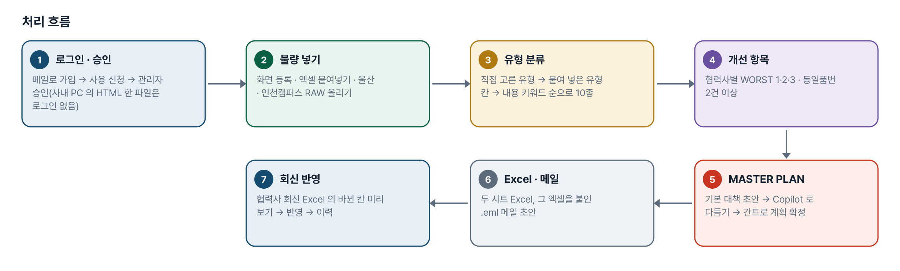
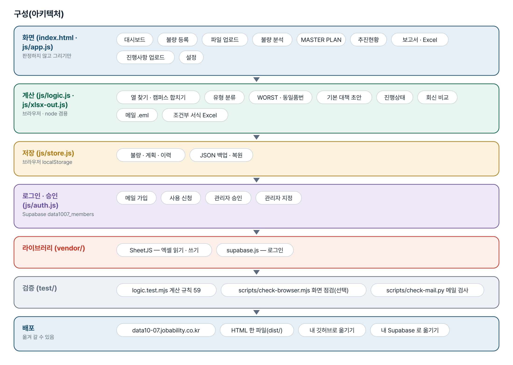
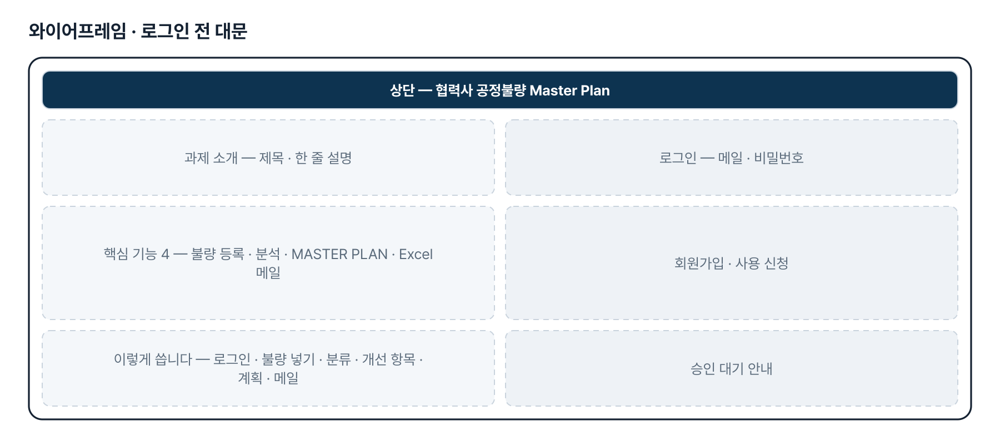
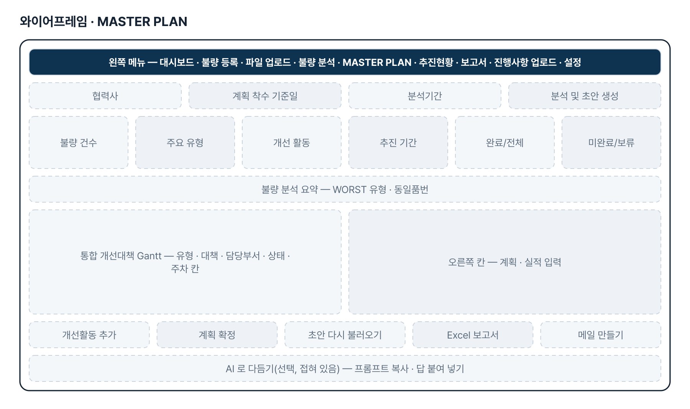
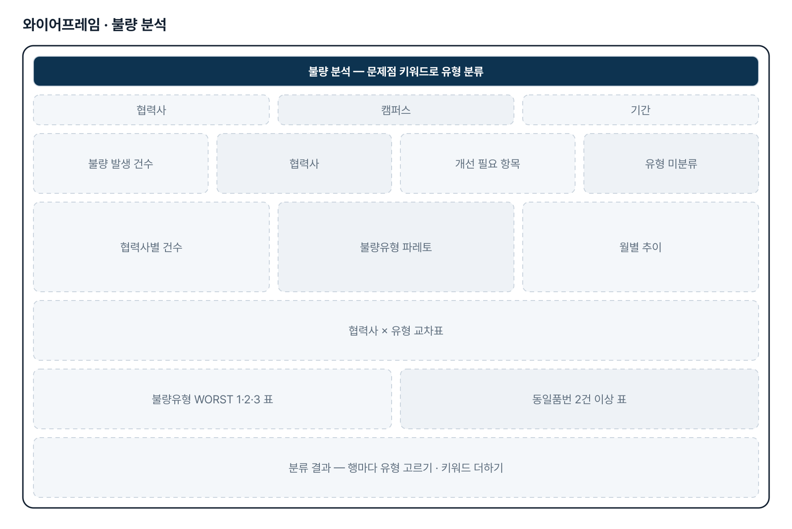
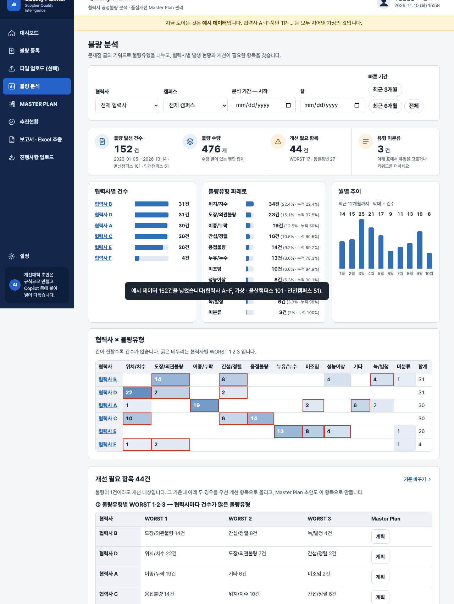

# 협력사 공정불량 Master Plan — 프로젝트 기획서 v2.0

- 기획: 이준호 · 작성일 2026-11-10 · 현장 데이터 디지털화 전문가과정 · 2차수 프로젝트 07
- 바로 쓰기: https://data10-07.jobability.co.kr/
- 워드 판: `docs/기획서/data10-07_이준호_협력사공정불량MasterPlan_기획서_v2.0.docx`

## 개요

협력사 공정불량을 등록하거나 캠퍼스별 RAW DATA 를 올려 불량유형 10종으로 나누고, WORST 1·2·3 · 동일품번 반복을 우선 개선 항목으로 개선 MASTER PLAN 초안과 간트를 만들어 협력사와 Excel · 메일로 진행사항을 주고받는 도구입니다.

### 배경 · 현재 업무
- 부품품질팀은 협력사별 공정불량을 분석해 품질개선 MASTER PLAN 을 세우고 관리해야 합니다.
- 공정불량 자료(발생일자 · 품명 · 품번 · 문제점 · 협력사)는 있으나 유형 분류와 개선 항목 도출, 계획 · 실적 관리가 손으로 이루어집니다.
- 회사는 통합됐지만 시스템은 통합 전이라 울산 · 인천캠퍼스 RAW DATA 가 열 구성이 다른 두 파일로 나옵니다.
- 사내 보안망에서 쓰여야 하고, 협력사와는 Excel 과 메일로 진행사항을 주고받습니다.

### 목표
- 공정불량을 불량유형 10종으로 자동 분류하고 협력사별 발생 현황을 보여 줍니다.
- 불량유형 WORST 1·2·3 과 동일품번 2건 이상을 우선 개선 항목으로 뽑아 MASTER PLAN 초안을 만듭니다.
- 간트로 계획 · 실적과 진행상태 4가지(진행중 · 완료 · 미완료 · 보류)를 색으로 관리합니다.
- 「불량목록」 · 「MASTER PLAN」 Excel 과 아웃룩 메일 초안으로 협력사와 주고받고, 회신을 다시 올려 반영합니다.

## 요구사항과 구현

| 기획서 요구 | 구현 |
|---|---|
| 공정불량 자동 분석 — 업로드 → 협력사별 불량유형 분류 · 발생 현황 · 주요 개선 필요 항목 | 불량 등록 · 엑셀 붙여넣기(기본)와 파일 업로드(선택), 불량유형 10종 키워드 분류, 파레토 · 월별 추이 · 협력사×유형 교차표, WORST 1·2·3 · 동일품번 2건 이상 |
| 개선 Master Plan 자동 생성 — 개선대책 · 담당부서 · 추진 일정 초안 | 유형별 기본 대책 규칙으로 초안, 담당부서 5종(협력사 내부), 「프롬프트 복사 → Copilot 에 붙여 넣기」로 다듬기 |
| 간트차트 기반 계획 · 실적 관리, 상태별 색 | 주차 · 월 간트(계획 · 실적 막대, 오늘 선), 진행상태 4가지 음영(완료 초록 · 진행중 주황 · 미완료 빨강 · 보류 회색), 계획 확정 이력 |
| Excel 보고서 자동 출력 | 「불량목록」 · 「MASTER PLAN」 두 시트, 협력사가 고치는 칸 표시, 진행상태 고르기 목록 + 조건부 서식 |
| 울산 · 인천캠퍼스 RAW DATA 구분(4차) | 캠퍼스 칸 2개 업로드 — 열 구성이 달라도 자동 연결, 캠퍼스 안에서만 중복 제거, 다시 올리면 그 캠퍼스만 바뀜, 캠퍼스 거르기 |
| 아웃룩 연동 메일(4차) | 설정의 수신 1~3 · 참조 1~3 · 초안, 그 협력사 MASTER PLAN 엑셀을 붙인 .eml(아웃룩이 새 메일로 엶)과 mailto |
| 협력사 회신으로 진행사항 갱신(3차) | 진행사항 업로드 — 숨긴 ID 로 행 맞추기, 바뀐 칸 미리 보기 · 충돌 고르기 · 반영 · 이력 |
| 사내망 사용 · 사내 PC 에서 HTML 로만 | 외부 서버 · CDN 을 부르지 않음, 도구 전체를 HTML 한 파일로 받아 더블클릭 |
| 가능하다면 사외망에서 접속 | 사이트 주소에 로그인 · 사용 승인을 붙임(이번 판). 업무 자료 공유 저장은 2단계 |

## 주요 기능

- **불량 등록 · 캠퍼스 RAW** — 한 건씩 적거나 엑셀 표를 붙여 넣고, 울산 · 인천캠퍼스 RAW DATA 를 각각 올려 합칩니다.
- **불량 분석** — 불량유형 10종으로 나눠 파레토 · 월별 추이 · 교차표를 보여 주고 WORST 1·2·3 · 동일품번을 뽑습니다.
- **MASTER PLAN · 간트** — 유형별 기본 대책으로 초안을 만들고 간트에서 계획 · 실적과 진행상태 4가지를 색으로 관리합니다.
- **Excel · 메일 · 회신** — 두 시트 Excel 과 아웃룩 메일 초안(.eml)으로 보내고, 협력사 회신 Excel 의 바뀐 칸만 반영합니다.
- **추진현황** — 모든 협력사의 개선과제를 진행상태별로 거르고 협력사별 표와 간트로 봅니다.
- **Copilot 로 다듬기** — 협력사 · 품번을 별칭으로 가린 프롬프트를 복사해 Copilot 등에 붙여 넣고 답을 받아 반영합니다.
- **HTML 한 파일** — 사내 PC 에 저장해 더블클릭으로 쓰는 판을 받습니다. 설치 · 인터넷이 필요 없습니다.
- **백업 · 복원** — JSON(전부) · 엑셀(불량 목록)로 받아 PC 를 바꾸거나 나눌 때 되살립니다.
- **로그인 · 사용 승인** — 회사 메일이나 개인 메일로 가입해 사용 신청, 관리자가 승인하면 씁니다.

## 처리 흐름(파이프라인)

1. **로그인 · 승인** — 메일로 가입 → 사용 신청 → 관리자 승인(사내 PC 의 HTML 한 파일은 로그인 없음)
2. **불량 넣기** — 화면 등록 · 엑셀 붙여넣기 · 울산 · 인천캠퍼스 RAW 올리기
3. **유형 분류** — 직접 고른 유형 → 붙여 넣은 유형 칸 → 내용 키워드 순으로 10종
4. **개선 항목** — 협력사별 WORST 1·2·3 · 동일품번 2건 이상
5. **MASTER PLAN** — 기본 대책 초안 → Copilot 로 다듬기 → 간트로 계획 확정
6. **Excel · 메일** — 두 시트 Excel, 그 엑셀을 붙인 .eml 메일 초안
7. **회신 반영** — 협력사 회신 Excel 의 바뀐 칸 미리 보기 → 반영 → 이력

## 구성(아키텍처)

- **화면 (index.html · js/app.js)** — 대시보드 · 불량 등록 · 파일 업로드 · 불량 분석 · MASTER PLAN · 추진현황 · 보고서 · Excel · 진행사항 업로드 · 설정
- **계산 (js/logic.js · js/xlsx-out.js)** — 열 찾기 · 캠퍼스 합치기 · 유형 분류 · WORST · 동일품번 · 기본 대책 초안 · 진행상태 · 회신 비교 · 메일 .eml · 조건부 서식 Excel
- **저장 (js/store.js)** — 불량 · 계획 · 이력 · JSON 백업 · 복원
- **로그인 · 승인 (js/auth.js)** — 메일 가입 · 사용 신청 · 관리자 승인 · 관리자 지정
- **라이브러리 (vendor/)** — SheetJS — 엑셀 읽기 · 쓰기 · supabase.js — 로그인
- **검증 (test/)** — logic.test.mjs 계산 규칙 59 · scripts/check-browser.mjs 화면 점검(선택) · scripts/check-mail.py 메일 검사
- **배포** — data10-07.jobability.co.kr · HTML 한 파일(dist/) · 내 깃허브로 옮기기 · 내 Supabase 로 옮기기

## 화면 구성(와이어프레임)

## 규칙 · 판정 기준

- 불량유형은 직접 고른 유형 → 붙여 넣은 유형 칸 → 내용 키워드 순으로 정합니다. 어느 것에도 맞지 않으면 미분류로 남겨 고르게 합니다.
- 개선 필요 항목 = 협력사별 불량유형 WORST 1·2·3 과 같은 품번 2건 이상(설정에서 바꿈).
- 진행상태: 완료 · 보류는 적은 그대로, 나머지는 개선 마감이 지났으면 미완료, 아니면 진행중(시작 전도 진행중).
- 중복은 같은 캠퍼스 안에서만 봅니다. 캠퍼스 RAW 를 다시 올리면 그 캠퍼스에서 올린 행만 바뀝니다.
- MASTER PLAN 과 WORST 는 협력사 단위(캠퍼스를 합쳐 셈)입니다.
- 회신 Excel 은 숨긴 ID 칸으로 행을 맞추고, 같은 파일을 다시 올려도 한 번만 반영합니다.

## 검증

- 계산 규칙 테스트 59개 통과
- node test/logic.test.mjs — 계산 규칙 59개 통과(2026-11-10). 60번째 「HTML 한 파일이 소스와 같은가」 검사는 로그인 키트를 index.html 에 넣은 뒤 dist 를 아직 다시 만들지 않아 실패합니다. 판을 올릴 때(bump-version) dist 를 다시 만들면 통과합니다.
- 4차 때 캠퍼스 키 · X-Unsent · 조건부 서식 · 첨부 · 시작 전 판정을 되돌려 테스트가 잡는 것을 확인했습니다.
- 메일 .eml 은 scripts/check-mail.py 가 파이썬 email 패키지 · openpyxl 로 다시 읽어 확인합니다. 실제 아웃룩에서 열어 보는 것은 사내 PC 몫입니다.
- 화면 점검 scripts/check-browser.mjs(선택) — 6가지 폭 × 9화면 넘침 0 · 외부 요청 0, SINGLE=1 은 HTML 한 파일로 같은 흐름.

## 이번 판에서 하지 않는 것

- 업무 자료(불량 · 계획 · 이력)는 아직 팀 공유 DB 가 아니라 이 브라우저에 저장됩니다. 나누려면 JSON · 엑셀 백업을 주고받습니다.
- 개선대책 초안은 규칙(기본 대책)으로 만들고, AI 는 프롬프트 복사 · 붙여 넣기가 기본입니다.
- 브라우저는 아웃룩을 직접 열거나 보내지 못해 .eml 파일로 건넵니다.
- 협력사가 사이트에 직접 들어와 입력하는 기능은 없습니다(Excel 회신으로 받음).

## 다음 단계

- 팀 공유 저장 — 두 캠퍼스 담당자가 같은 불량 · 계획을 함께 보기
- 사외망에서 협력사가 회신을 직접 올리는 화면(필요하면)
- MASTER PLAN 을 캠퍼스별로 나눌지, 시작 전 활동을 따로 볼지 확인 후 반영

## 버전 이력

- **v2.0** (2026-11-10) — 최종 기획서 — 파이프라인 · 아키텍처 · 와이어프레임 정리 / 로그인 · 사용 신청 · 관리자 승인(요청자 Supabase 로 옮길 수 있게) / 로그인 전 대문 / HTML 한 파일 안내에서 옛 사이트 주소를 뺌(옮겨도 깨지지 않게)
- **v1.3** (2026-10-28) — 4차 — 울산 · 인천캠퍼스 RAW DATA · 진행상태 4가지(진행률 삭제) · 음영(조건부 서식) · 아웃룩 메일 초안(.eml)
- **v1.2** (2026-10-27) — 3차 — 담당부서 5종 · 불량유형 10종 · WORST · 동일품번 · Copilot · Excel 두 시트 · 진행사항 업로드 · HTML 한 파일
- **v1.1** (2026-10-21) — 2차 — 불량 등록 · 엑셀 붙여넣기 기본, 불량유형 8종, 화면 그대로 Excel, 사내망 전용
- **v1.0** (2026-10-20) — 1단계 — 업로드 · 분석 · Master Plan · 간트 · 보고서
